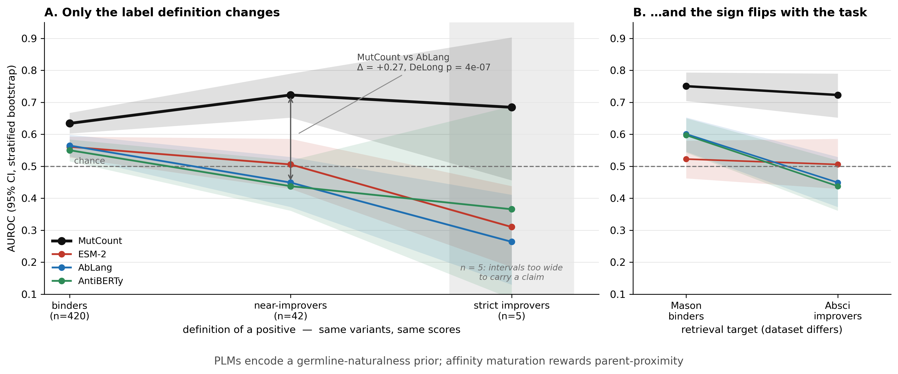
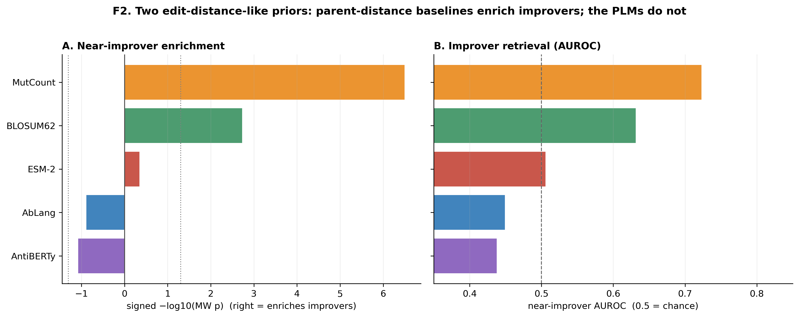
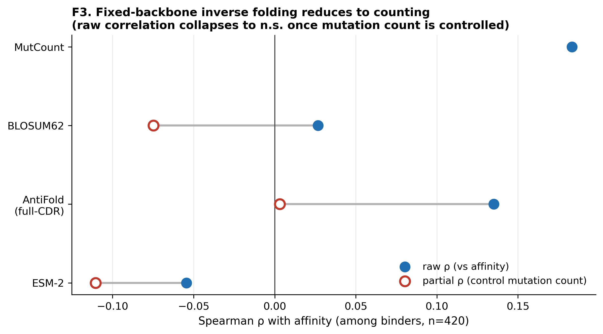
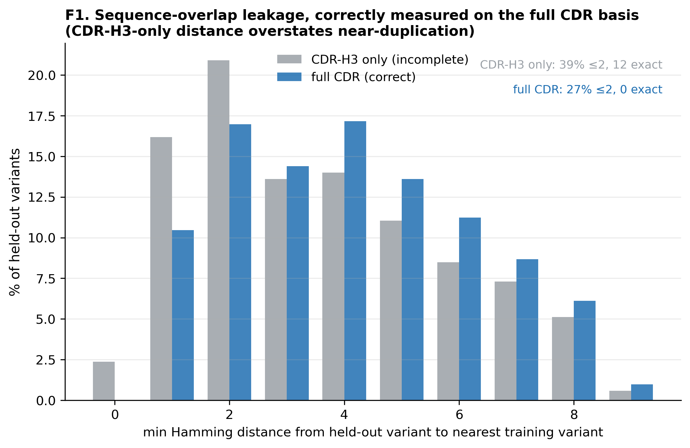
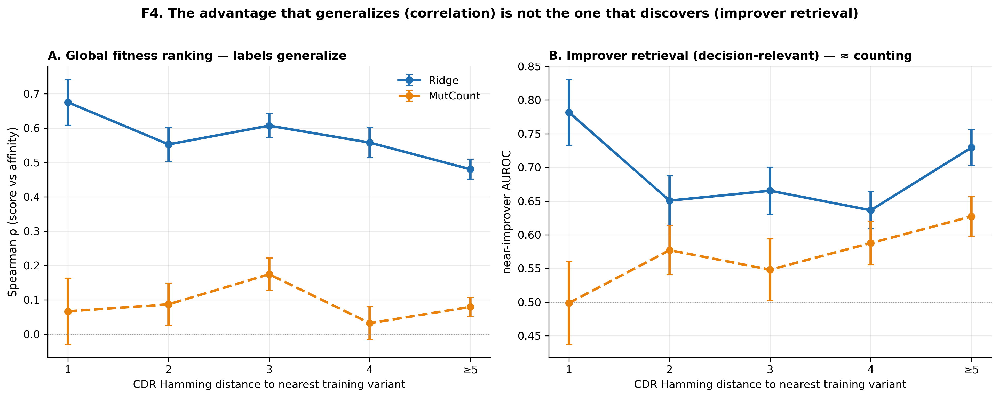

# Antibody PLM Benchmark

**Do protein language models actually help choose better antibodies? On this benchmark — no. And the standard way of evaluating them hides that.**

Antibody engineering teams increasingly rank candidate molecules with protein
language models (PLMs), structure models, or small supervised models. I tested
those methods against deliberately trivial baselines on a real
affinity-maturation task and found that **none of them reliably beats simply
counting mutations.** The durable contribution here is not the negative result
but the *evaluation protocol* that reveals it — and a worked demonstration that
the evaluation design, not the model, often decides the published conclusion.

<p align="center">
  
</p>

**The sharpest single result, shown above.** Hold the dataset and the model
scores completely fixed and change *only* what counts as a "good" variant. A
parameter-free mutation counter rises from AUROC 0.63 [0.60–0.67] to 0.72
[0.65–0.79], while AbLang falls from 0.56 [0.53–0.60] to 0.45 [0.37–0.53] — at or
below chance (n = 420 → n = 42; paired DeLong, Δ = 0.27, **p = 4.3×10⁻⁷**).
Nothing about the models changed. Antibody PLMs encode a germline-*naturalness*
prior, and affinity maturation is not a germline-proximity problem.

## At a glance

| | |
|---|---|
| **Problem** | Which antibody variants should a team synthesise next, given a few measured examples? |
| **Data** | 1,266 trastuzumab CDR variants with SPR Kd (Absci); 36,391 CDR-H3 variants with FACS labels (Mason 2021); KyDab multi-target panel |
| **Methods compared** | mutation count, BLOSUM62, ESM-2 (650M), AbLang, AntiBERTy, AntiFold (inverse folding), ridge regression, LoRA fine-tuning |
| **Statistics** | stratified bootstrap CIs, paired DeLong tests, partial correlation, tie-corrected Mann–Whitney, Bonferroni |
| **Reusable output** | A 6-point evaluation protocol for vetting any affinity-ranking method |

## Why this matters

Affinity maturation is resource-bound. From a large combinatorial library a team
can only synthesise and assay a small number of variants per round, so the
decision that spends the budget is not *"predict every Kd"* but *"put the rare
improvers at the top of a short list."* A model can look strong on global
correlation and still be useless at that decision.

Two properties of combinatorial antibody data make standard benchmarks
optimistic. Fitness correlates with edit distance from the parent, so any score
tracking mutation count inherits signal it did not earn; and random splits place
near-duplicates of training variants into the test set, so a model can memorise
rather than generalise. This benchmark separates both.

## Findings

### 1. Two priors, and only one finds improvers

Mutation count (MW p = 3.2×10⁻⁷) and BLOSUM62 (p = 1.9×10⁻³) significantly
enrich improvers; the antibody PLMs do not. The PLMs are not broken — they
encode a *different* prior. Its usefulness **flips with the task**: on Mason the
same PLMs *enrich* binders (n = 154 binders of 500 variants; p ≈ 10⁻⁴), because
binders there happen to be low-mutation.

<p align="center"></p>

### 2. Fixed-backbone structure reduces to counting

AntiFold scored on the trastuzumab–HER2 crystal out-enriches BLOSUM, yet its
correlation with affinity vanishes once mutation count is controlled
(raw ρ = +0.135 → partial ρ = +0.003, n.s.; ρ = −0.71 with mutation count). We
raise as a testable question whether reported inverse-folding advantages are
partly a mutation-count artifact.

<p align="center"></p>

### 3. A correlation edge is not a discovery edge

Combinatorial libraries leak: a random split puts near-duplicates in the test
set. With distance-aware splits, ridge regression keeps a *correlation*
advantage (ρ 0.68 → 0.48 vs a flat counter) but matches counting on the metric
that reflects the actual decision — a stringent, budget-matched precision@K. On
near-improver AUROC (n = 42, 20 seeds) the edge nearly closes: Ridge 0.72 ± 0.03
vs MutCount 0.65 ± 0.03 at d ≥ 5, a +0.06 gap, down from +0.36 at d = 1.

<p align="center">
  
  
</p>

### 4. Fine-tuning does not rescue it

LoRA fine-tuning of ESM-2-650M on Mason binder classification does not beat
one-hot baselines on the same split:

Every comparison is against the fine-tuned model, so the LoRA row itself is
the reference — its own score is the ROC-AUC column.

**Random (optimistic) split** — n = 3640, 1128 positives:

| method | features / trainable | ROC-AUC | vs LoRA (paired DeLong) |
|---|---:|---:|---|
| LR on mutation count | 1 | 0.771 | LoRA better, p = 3×10⁻⁵² |
| LR on one-hot CDR-H3 | 200 | 0.897 | tie, p = 0.87 |
| ESM-2-650M + LoRA (r = 8) | 7.7 M | 0.896 | *(reference row)* |
| **MLP(128) on one-hot** | 200 | **0.920** | **MLP better, p = 1.4×10⁻⁹** |

**Distance-aware split** — every test sequence ≥ 3 substitutions from every
training sequence (leave-cluster-out at Hamming ≤ 2); n = 3639, 595 positives:

| method | ROC-AUC | change | vs LoRA (paired DeLong) |
|---|---:|---:|---|
| LR on mutation count | 0.661 | −0.110 | LoRA better, p = 2×10⁻⁴⁰ |
| LR on one-hot CDR-H3 | 0.846 | −0.051 | tie, p = 0.115 |
| ESM-2-650M + LoRA (r = 8) | 0.834 | **−0.062** | *(reference row)* |
| **MLP(128) on one-hot** | **0.870** | −0.050 | **MLP better, p = 1.2×10⁻⁷** |

**The conclusion is robust to the evaluation regime, which is the point.** Under
both splits the fine-tuned 650M-parameter PLM ties a logistic regression on 200
one-hot features and loses to a 128-unit MLP on those same features. It does beat
the mutation-count baseline, so supervision buys something — just not more than
one-hot encoding does. Removing leakage costs every method and costs the PLM
**most** (−0.062 vs −0.050), widening the MLP gap from −0.024 to −0.036.

*Caveat, stated rather than buried:* the distance-aware split shifts class balance
(train 34.6% positive, test 16.4%), because binders are low-mutation and cluster
into the giant component assigned to training. AUROC is prevalence-robust, so
comparisons within each split hold — but absolute values are **not** comparable
across the two tables, which is why they are shown separately. Test metrics use
last-epoch weights. Artifacts: `results/mason/mason_finetune_baselines{,_distance}.csv`
and `..._delong{,_distance}.csv`, via `training/leak_check.py`.

## The evaluation protocol

The reusable contribution: a pre-campaign checklist for vetting any
affinity-ranking method, internal or vendor.

1. Report a **mutation-count baseline** (and BLOSUM62) — most methods here do not beat it
2. Use **distance-/cluster-aware splits**; quantify near-duplicate leakage. Random-split
   validation on a combinatorial library returns an optimistic upper bound
3. Report **budget-matched precision@K**, not only global correlation
4. **Separate the tiers** — binder vs beat-parent (improver) retrieval
5. **Control for mutation count** via partial correlation
6. **Correct for multiple comparisons**; label borderline effects nominal

One routing implication beyond the checklist: antibody PLMs earn their place on
humanness, developability and immunogenicity. This benchmark is evidence against
using them to rank affinity improvers — a different objective, and the germline
prior points the wrong way for it.

## What I corrected

Several early numbers moved under scrutiny. Corrected values are below; the full
log is in `docs/validation_checklist.md`.

- **Full-CDR basis.** The first analysis scored CDR-H3 only; Absci variants also
  vary in HCDR1/HCDR2. Re-ran on the complete 29-position basis. Conclusions held.
- **Leakage overstated.** CDR-H3-only distance exaggerated near-duplication:
  within-Hamming-≤2 overlap 39% → 27%, exact duplicates 14 → 0.
- **A signal demoted.** ESM-2's partial correlation was nominally anti-fitness on
  the CDR-H3 basis (ρ = −0.11, p = 0.02) but did not survive full-CDR re-scoring.
  Dropped.
- **Tie correction.** Strict-tier enrichment p rested on a score tie; midrank
  Mann–Whitney moved it 0.028 → 0.075. Now applied to every rank statistic.
- **Mason flipped the thesis.** I expected the anti-ranking to replicate; instead
  PLMs *enrich* binders there. The sign depends on the task — this became
  load-bearing rather than a failed replication.
- **Testing differences, not intervals.** Per-model bootstrap CIs do not test a
  difference between two correlated AUCs; added a paired DeLong test
  (`evaluation/delong.py`).

## Reproducing this

Every number comes from a committed script, and metrics recompute from the scored
CSVs without re-running any model. `docs/CODEMAP.md` documents every script, its
output and its role, and glosses the `DEC-NNN` decision markers used in comments;
`docs/validation_checklist.md` names the artifact behind each claim.

```bash
conda env create -f environment.yml
conda env create -f environment_antifold.yml   # optional: AntiFold (isolated pins)

python scripts/merge_fitness.py absci --raw <your absci table>   # restore measured values

python experiments/e1_antirank.py             # zero-shot enrichment
python experiments/e1c_label_definition.py           # the label-definition result (F5)
python experiments/e2f_distance_split.py      # leakage-free supervised
python experiments/e4b_fullcdr_eval.py        # structure partial-ρ
python training/leak_check.py --dataset mason --split distance --d-link 2
python figures/make_figures.py                # F1–F4
```

`run_benchmark.py` regenerates the model scores everything else reads. You should
not need it: those scores are committed, and it requires torch plus every model's
weights.

### Data — not redistributed

Source datasets (Absci HER2 SPR Kd, Mason 2021 FACS, KyDab) are **not** included.
Tables in `results/` carry computed columns only (sequences, mutation counts,
model scores); measured values are stripped. Download from the original sources
(`data/raw/README.md`) and restore with `scripts/merge_fitness.py <absci|mason|kydab>
--raw <path>`. Model weights, PLM embeddings and the 1N8Z crystal are fetched by
the code, not committed.

## Repository layout

49 Python files, 43 committed result tables, 5 figures. Every script and
module is documented in `docs/CODEMAP.md`, with its inputs, outputs and role.

```
run_benchmark.py          score every model over a dataset -> results/<ds>/<ds>_all_scored.csv
reevaluate.py             recompute the metric suite from those scores (no model re-run)
environment.yml           analysis env (numpy/scipy/sklearn/torch/transformers)
environment_antifold.yml  structure env — isolated, its pins conflict with the above
LICENSE                   MIT (code and computed outputs only)

models/         5  zero-shot scorers: BLOSUM62, ESM-2, AbLang, AntiBERTy
evaluation/     7  metric libraries — improver retrieval, low-N protocol, DeLong,
                   partial Spearman, IMGT stratification, results-path resolver
experiments/   21  drivers — e1* zero-shot · e2* few-shot + leakage · e4* structure,
                   plus kydab_eval (out-of-distribution) and extract_embeddings
structures/     3  AntiFold fixed-backbone scoring on the 1N8Z crystal
training/      10  LoRA fine-tuning, the leak-check / baseline comparison, a contract
                   test, and checkpoints/ (run config + logs only, never weights)
scripts/        1  merge_fitness.py — restore stripped measured values
data/           4  download + process Mason / Absci / KyDab (raw data not shipped)
results/       44  computed scores + derived metrics, grouped by dataset
figures/        8  F1–F5, their two generators, and a caption index
docs/           2  CODEMAP.md (every script) · validation_checklist.md (every claim)
```

The `e1/e2/e4` prefixes are experiment IDs: they tie each script to the result
table it writes (`absci_e2g_dist_stratified.csv`) and to the figure it feeds, so a
number can be traced back to the code that produced it in one step.

## Status

All four research arms — zero-shot, few-shot supervised, structure, fine-tuning —
are complete and reproducible from the committed scores. **In progress:**
manuscript draft (workshop methods contribution). **Planned:** expansion to
further combinatorial antibody datasets, and a fine-tuning arm on Absci (the
current fine-tuning evidence is Mason-only).

## Limitations

Single target (trastuzumab / HER2). The strict improver tier is n = 5, which is
reported with its interval and is too small to carry a claim — the headline rests
on the n = 42 tier. The structure arm is fixed-backbone only. Zero-shot PLM
scores model CDR-H3 variation only; HCDR1/2 variation (20% of variants, 0% of
improvers) is unmodelled, and conclusions were re-verified on the exactly-scored
subset. Full log in `docs/validation_checklist.md`.

## License

Code and computed outputs: MIT. Third-party datasets and model weights are not
covered and not redistributed.
