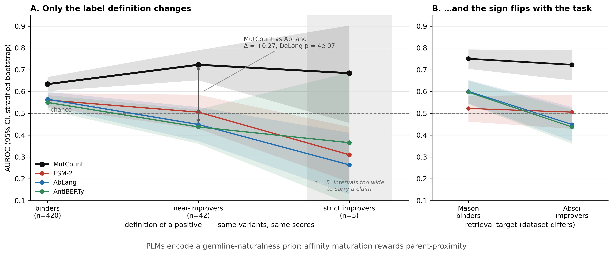
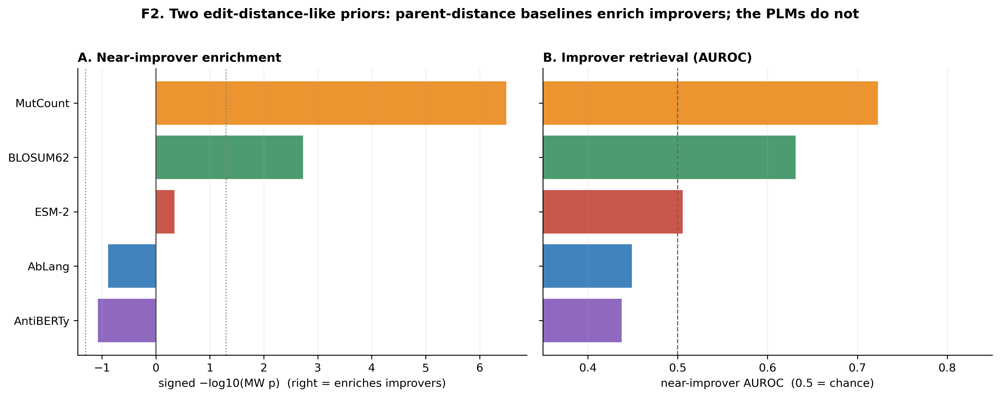
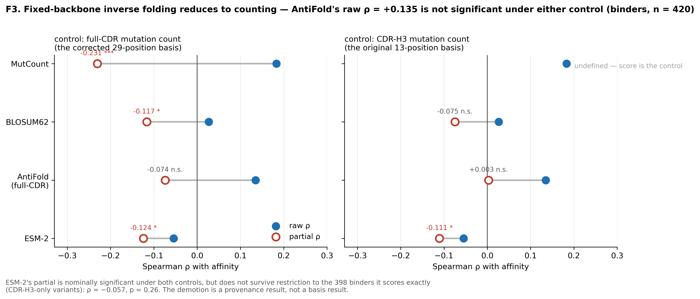
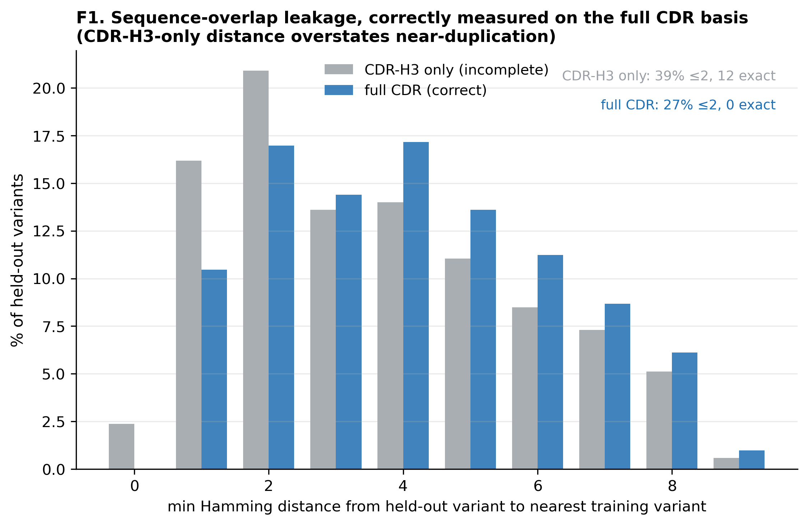
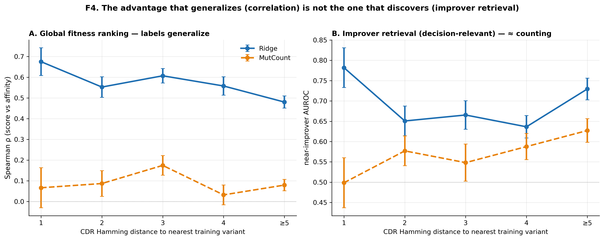

# Antibody PLM Benchmark

**Do protein language models actually help choose better antibodies? On this benchmark — no. And the standard way of evaluating them hides that.**

Antibody engineering teams increasingly rank candidate molecules with protein
language models (PLMs), structure models, or small supervised models. I tested
those methods against deliberately trivial baselines on a real
affinity-maturation task. **No zero-shot method reliably beats simply counting
mutations** — and the supervised methods that *do* beat it gain nothing from the
pretrained model: across three datasets a LoRA fine-tune of ESM-2-650M never
outperforms a one-hot or 3-mer encoding of the same sequence. The durable
contribution here is not the negative result
but the *evaluation protocol* that reveals it — and a worked demonstration that
the evaluation design, not the model, often decides the published conclusion.

<p align="center">
  
</p>

**The sharpest single result, shown above.** Hold the dataset and the model
scores completely fixed and change *only* what counts as a "good" variant. A
parameter-free mutation counter **holds** — 0.634 [0.602–0.667] on binders
(n = 420), 0.723 [0.652–0.790] on near-improvers (n = 42). Those intervals
overlap, so the apparent rise is *not* separable; the claim is that the counter
does not degrade. **Every PLM does:** AbLang falls from 0.565 [0.531–0.599] to
0.449 [0.373–0.529], at or below chance. The counter beats AbLang at *both*
tiers — paired DeLong Δ = +0.069, p = 3.3×10⁻⁴ on binders and Δ = +0.274,
**p = 4.3×10⁻⁷** on near-improvers — and on Mason binders it reaches 0.750
against ESM-2's 0.523 (n = 154, p = 1.1×10⁻¹¹). Nothing about the models changed. Antibody PLMs encode a germline-*naturalness*
prior, and affinity maturation is not a germline-proximity problem.

## At a glance

| | |
|---|---|
| **Problem** | Which antibody variants should a team synthesise next, given a few measured examples? |
| **Data** | 1,266 trastuzumab CDR variants with SPR Kd (Absci); 36,391 CDR-H3 variants with FACS labels (Mason 2021 — the zero-shot arm scores a 500-variant subsample, the fine-tuning arm uses all of it); KyDab multi-target panel |
| **Methods compared** | mutation count, BLOSUM62, ESM-2 (650M), AbLang, AntiBERTy, AntiFold (inverse folding), ridge regression, LoRA fine-tuning |
| **Statistics** | stratified bootstrap CIs, paired DeLong tests, partial correlation, tie-corrected Mann–Whitney, Bonferroni |
| **Reusable output** | A 6-point evaluation protocol for vetting any affinity-ranking method |

## Why this matters

Affinity maturation is resource-bound. From a large combinatorial library a team
can only synthesise and assay a small number of variants per round, so the
decision that spends the budget is not *"predict every Kd"* but *"put the rare
improvers at the top of a short list."* A model can look strong on global
correlation and still be useless at that decision.

Two properties of combinatorial antibody data make standard benchmarks
optimistic. Fitness correlates with edit distance from the parent, so any score
tracking mutation count inherits signal it did not earn; and random splits place
near-duplicates of training variants into the test set, so a model can memorise
rather than generalise. This benchmark separates both.

## Findings

### 1. Two priors, and only one finds improvers

Mutation count (MW p = 3.2×10⁻⁷) and BLOSUM62 (p = 1.9×10⁻³) significantly
enrich improvers; the antibody PLMs do not. The PLMs are not broken — they
encode a *different* prior. Its usefulness **flips with the task**: on Mason the
two *antibody* PLMs enrich binders (AbLang p = 1.6×10⁻⁴, AntiBERTy p = 2.6×10⁻⁴;
n = 154 binders of a 500-variant subsample), because binders there happen to be
low-mutation. General-purpose ESM-2 does not (p = 0.21) — the flip is a property
of the germline prior, not of PLMs in general.

<p align="center"></p>

### 2. Fixed-backbone structure reduces to counting

AntiFold, scored on the trastuzumab–HER2 crystal (PDB 1N8Z) against **Absci HER2
SPR affinity** (n = 420 binders), out-enriches BLOSUM — yet its correlation with
affinity vanishes once mutation count is controlled. On the full-CDR basis
(29 varying positions, the corrected one): raw ρ = +0.135 (p = 0.0056), ρ = −0.708 against
full-CDR mutation count, **partial ρ = −0.074 (p = 0.13, n.s.)**. Controlling for
CDR-H3 count instead gives partial ρ = +0.003 — same verdict, different basis.
We raise as a testable question whether reported inverse-folding advantages are
partly a mutation-count artifact.

*All three numbers share one control variable, so they reconcile under the
partial-correlation identity; a raw ρ from one basis quoted beside a
control-correlation from another does not.*

<p align="center"></p>

### 3. A correlation edge is not a discovery edge

Combinatorial libraries leak: a random split puts near-duplicates in the test
set. Binning test binders by distance to the nearest training variant separates
the two things a model can be good at. Ridge keeps a **correlation** that decays
but survives — ρ 0.68 ± 0.07 at d = 1 falling to 0.46 ± 0.03 at d ≥ 5, a 1.5×
inflation from leakage alone — while its **discovery** edge over a plain mutation
counter shrinks threefold: near-improver AUROC 0.73 ± 0.03 vs 0.63 ± 0.03 at
d ≥ 5 (gap +0.10), down from +0.29 at d = 1. Labels generalise for ranking the
bulk, far less for finding the rare top.

*Both bases agree on the shape; the numbers above are all full-CDR (20 seeds,
`results/absci/absci_e2g_dist_stratified_fullcdr.csv`). On the CDR-H3 basis the
decay is steeper (ρ 0.81 → 0.46) and the discovery gap closes further (+0.37 →
+0.06). The ρ pair is a leakage before/after, **not** a comparison against the
counter: the counter's own ρ is +0.066 at d = 1 and +0.079 at d ≥ 5.*

<p align="center">
  
  
</p>

### 4. Fine-tuning does not rescue it

LoRA fine-tuning of ESM-2-650M, on both datasets, against baselines fitted on
the same splits. It never beats one-hot encoding of the same sequences:

Every comparison is against the fine-tuned model, so the LoRA row itself is
the reference — its own score is the ROC-AUC column.

**Random (optimistic) split** — n = 3640, 1128 positives:

| method | features / trainable | ROC-AUC | vs LoRA (paired DeLong) |
|---|---:|---:|---|
| LR on mutation count | 1 | 0.771 | LoRA better, p = 3×10⁻⁵² |
| LR on one-hot CDR-H3 | 200 | 0.897 | tie, p = 0.87 |
| ESM-2-650M + LoRA (r = 8) | 7.7 M | 0.896 | *(reference row)* |
| **MLP(128) on one-hot** | 200 | **0.920** | **MLP better, p = 1.4×10⁻⁹** |

**Distance-aware split** — every test sequence ≥ 3 substitutions from every
training sequence (leave-cluster-out at Hamming ≤ 2); n = 3639, 595 positives:

| method | ROC-AUC | change | vs LoRA (paired DeLong) |
|---|---:|---:|---|
| LR on mutation count | 0.661 | −0.110 | LoRA better, p = 2×10⁻⁴⁰ |
| LR on one-hot CDR-H3 | 0.846 | −0.051 | tie, p = 0.115 |
| ESM-2-650M + LoRA (r = 8) | 0.834 | **−0.062** | *(reference row)* |
| **MLP(128) on one-hot** | **0.870** | −0.050 | **MLP better, p = 1.2×10⁻⁷** |

**The conclusion is robust to the evaluation regime, which is the point.** Under
both splits the fine-tuned 650M-parameter PLM ties a logistic regression on 200
one-hot features and loses to a 128-unit MLP on those same features. It does beat
the mutation-count baseline, so supervision buys something — just not more than
one-hot encoding does. Removing leakage costs every method and costs the PLM
**most** (−0.062 vs −0.050), widening the MLP gap from −0.024 to −0.036.

**Absci — HER2 SPR binder classification** (test n = 124 random / 123 distance):

| method | random | distance |
|---|---:|---:|
| LR on mutation count | 0.658 | 0.644 |
| LR on one-hot CDR-H3 | **0.943** | **0.939** |
| ESM-2-650M + LoRA (r = 8) | 0.935 | 0.903 |
| MLP(128) on one-hot | 0.931 | 0.924 |

Same shape as Mason: LoRA beats mutation count (p = 9.6×10⁻⁹ / 7.3×10⁻⁶) and ties
both one-hot models (p = 0.51 / 0.16 vs LR, p = 0.76 / 0.42 vs MLP). *Absci is the
weaker of the two tests and is not independent confirmation of everything Mason
shows:* its test set is 124 variants against Mason's 3,640, so standard errors are
0.013–0.027 rather than 0.004–0.008. Mason's clearest result — the MLP beating
LoRA by 0.024 at p = 1.4×10⁻⁹ — **would be undetectable at this n**.

### Does fine-tuning fix the anti-prediction of improvers?

The question the benchmark exists to ask, and a binder AUROC does not answer it —
binder retrieval and improver retrieval are different tasks (finding 1). One
held-out Absci split holds 2 strict and 7 near improvers, so the test is
**cross-fitted**: 5 folds, every variant scored by a model that never saw it,
putting all 42 near-improvers and all 5 strict improvers in play at once.

| scorer | near-improver AUROC (n = 42) | strict (n = 5) |
|---|---|---|
| ESM-2 + LoRA, cross-fitted | 0.901 [0.849–0.939] | 0.905 [0.815–0.969] |
| LR on one-hot, cross-fitted (same folds) | 0.901 [0.873–0.926] | 0.887 [0.799–0.961] |
| mutation count | 0.724 [0.649–0.794] | 0.686 [0.457–0.905] |
| ESM-2 zero-shot | 0.510 [0.430–0.594] | 0.313 [0.192–0.454] |
| AbLang zero-shot | 0.451 [0.369–0.533] | 0.266 [0.135–0.417] |

**Yes — and the PLM contributes nothing to the fix.** Supervision removes the
anti-prediction outright: AbLang's 0.451, below chance, becomes 0.901. But the
fine-tuned 650M-parameter model and a logistic regression on 260 one-hot features
are indistinguishable — **Δ = −0.0001, p = 0.995** (paired DeLong, identical
folds) — while both beat mutation count (Δ = +0.177, p = 6.8×10⁻⁷).

What fixes improver ranking is **labels, not the pretrained representation**. The
strict tier agrees in direction, but n = 5 and the intervals overlap heavily; it
carries no claim on its own.

Artifacts: `results/absci/absci_finetune_improver.csv` and `..._finetune_oof.csv`,
via `training/finetune_cv.py` + `experiments/e5_finetune_improver.py`.

*Caveat, stated rather than buried:* the distance-aware split shifts class balance
(train 34.6% positive, test 16.4%), because binders are low-mutation and cluster
into the giant component assigned to training. AUROC is prevalence-robust, so
comparisons within each split hold — but absolute values are **not** comparable
across the two tables, which is why they are shown separately. Test metrics use
last-epoch weights. Artifacts: `results/mason/mason_finetune_baselines{,_distance}.csv`
and `..._delong{,_distance}.csv`, via `training/leak_check.py`.

### KyDab — the generalisation check, on a panel that is not a combinatorial library

KyDab is natural antibodies from four immunisations, and it **breaks three of the
four comparisons above by construction** — which is itself worth stating:

- **no parent**, so "mutation count from WT" does not exist and neither does the
  improver tier. Findings 1–3 cannot be rerun here;
- **CDR-H3 length varies** (8–24 residues), so the one-hot baseline that carries
  the argument above does not apply;
- **four different antigens**; a CDR-H3-only model cannot know which target it is
  predicting for, so each antigen is fitted separately. Only typhi-01 (374 unique
  sequences) and pertussis (258) are large enough to train on at all.

What remains well-posed is affinity *ranking within an antigen*. Cross-fitted
5-fold, against a ridge on 3-mer counts — a supervised comparator on the same
folds, since k-mers handle variable length and one-hot does not:

| scorer | typhi-01 (n = 365) | pertussis (n = 258) |
|---|---:|---:|
| **Ridge on 3-mer counts**, cross-fitted | **+0.348** | **+0.451** |
| ESM-2-650M + LoRA, cross-fitted | +0.175 | +0.233 |
| ESM-2 zero-shot (PLL) | +0.101 | −0.002 |
| AbLang zero-shot (PLL) | −0.154 | −0.016 |
| CDR-H3 length | +0.023 | −0.076 |

Spearman ρ against neg_log_Kd. **Here the fine-tuned PLM does not tie the trivial
baseline — it loses to it**, on both antigens: Δ = −0.173 [−0.281, −0.063],
p = 0.002 on typhi-01 and Δ = −0.218 [−0.345, −0.087], p < 0.001 on pertussis
(paired bootstrap over variants, since two Spearman ρ on the same rows are
correlated). Fine-tuning does learn *something* — it beats CDR-H3 length on both
and zero-shot ESM-2 on pertussis — just far less than a bag of 3-mers.

Per-fold R² is mostly **negative** (−1.07 to +0.14 on typhi-01), so the model does
not predict absolute affinity at all; only the ranking is weakly positive.

*This is a different task from the arms above — affinity regression on natural
antibodies, not improver retrieval on a mutant library — so it is evidence that
travels with that caveat attached, not a fourth replication.*

Artifacts: `results/kydab/kydab_finetune_eval.csv`, `kydab_*_finetune_oof.csv`,
via `training/finetune_cv.py --dataset kydab --antigen <project>` +
`experiments/e6_kydab_finetune.py`.

**Across three datasets, the fine-tuned 650M model never beats a cheap encoding of
the same sequence** — it ties one-hot on Mason and Absci and loses to 3-mers here.

## The evaluation protocol

The reusable contribution: a pre-campaign checklist for vetting any
affinity-ranking method, internal or vendor.

1. Report a **mutation-count baseline** (and BLOSUM62) — most methods here do not beat it
2. Use **distance-/cluster-aware splits**; quantify near-duplicate leakage. Random-split
   validation on a combinatorial library returns an optimistic upper bound
3. Report **budget-matched precision@K**, not only global correlation
4. **Separate the tiers** — binder vs beat-parent (improver) retrieval
5. **Control for mutation count** via partial correlation
6. **Correct for multiple comparisons**; label borderline effects nominal

One routing implication beyond the checklist: antibody PLMs earn their place on
humanness, developability and immunogenicity. This benchmark is evidence against
using them to rank affinity improvers — a different objective, and the germline
prior points the wrong way for it.

## What I corrected

Several early numbers moved under scrutiny. Corrected values are below; the full
log is in `docs/validation_checklist.md`.

- **Full-CDR basis.** The first analysis scored CDR-H3 only; Absci variants also
  vary in HCDR1/HCDR2. Re-ran on the complete 29-position basis. Conclusions held.
- **Leakage overstated.** CDR-H3-only distance exaggerated near-duplication:
  within-Hamming-≤2 overlap 39.1% → 26.3%, exact duplicates 14 → 0 — measuring
  on CDR-H3 alone overstated leakage by about 1.5×. This is a **basis**
  correction, not the distance-aware split (that is the separate e2f arm).
- **A signal demoted.** ESM-2's partial correlation is nominally anti-fitness
  (ρ = −0.111, p = 0.023; −0.124, p = 0.011 controlling for full-CDR count). It
  does not survive restricting to the 398 binders ESM-2 scores correctly —
  CDR-H3-only variants — where it falls to **ρ = −0.057, p = 0.26**. Dropped on
  that provenance evidence; the signal is *stronger*, not weaker, on the
  full-CDR basis.
- **Tie correction.** Strict-tier enrichment p rested on a score tie; midrank
  Mann–Whitney moved it 0.028 → 0.075. Now applied to every rank statistic.
- **Mason flipped the thesis.** I expected the anti-ranking to replicate; instead
  the antibody PLMs *enrich* binders there (ESM-2 does not). The sign depends on
  the task — this became load-bearing rather than a failed replication.
- **Testing differences, not intervals.** Per-model bootstrap CIs do not test a
  difference between two correlated AUCs; added a paired DeLong test
  (`evaluation/delong.py`).

## Reproducing this

Every number comes from a committed script, and metrics recompute from the scored
CSVs without re-running any model. `docs/CODEMAP.md` documents every script, its
output and its role, and glosses the `DEC-NNN` decision markers used in comments;
`docs/validation_checklist.md` names the artifact behind each claim.

```bash
conda env create -f environment.yml
conda env create -f environment_antifold.yml   # optional: AntiFold (isolated pins)

python scripts/merge_fitness.py absci --raw <your absci table>   # restore measured values

python experiments/e1_antirank.py             # zero-shot enrichment
python experiments/e1c_label_definition.py           # the label-definition result (F5)
python experiments/e2f_distance_split.py      # leakage-free supervised
python experiments/e4b_fullcdr_eval.py        # structure partial-ρ
python training/leak_check.py --dataset mason --split distance --d-link 2
python figures/make_figures.py                # F1–F4
```

`run_benchmark.py` regenerates the model scores everything else reads. You should
not need it: those scores are committed, and it requires torch plus every model's
weights.

### Data — not redistributed

Source datasets (Absci HER2 SPR Kd, Mason 2021 FACS, KyDab) are **not** included.
Tables in `results/` carry computed columns only (sequences, mutation counts,
model scores); measured values are stripped. Download from the original sources
(`data/raw/README.md`) and restore with `scripts/merge_fitness.py <absci|mason|kydab>
--raw <path>`. Model weights, PLM embeddings and the 1N8Z crystal are fetched by
the code, not committed.

## Repository layout

49 Python files, 43 committed result tables, 5 figures. Every script and
module is documented in `docs/CODEMAP.md`, with its inputs, outputs and role.

```
run_benchmark.py          score every model over a dataset -> results/<ds>/<ds>_all_scored.csv
reevaluate.py             recompute the metric suite from those scores (no model re-run)
environment.yml           analysis env (numpy/scipy/sklearn/torch/transformers)
environment_antifold.yml  structure env — isolated, its pins conflict with the above
LICENSE                   MIT (code and computed outputs only)

models/         5  zero-shot scorers: BLOSUM62, ESM-2, AbLang, AntiBERTy
evaluation/     7  metric libraries — improver retrieval, low-N protocol, DeLong,
                   partial Spearman, IMGT stratification, results-path resolver
experiments/   23  drivers — e1* zero-shot · e2* few-shot + leakage · e4* structure,
                   plus kydab_eval (out-of-distribution) and extract_embeddings
structures/     3  AntiFold fixed-backbone scoring on the 1N8Z crystal
training/      15  LoRA fine-tuning, the leak-check / baseline comparison, a contract
                   test, and checkpoints/ (run config + logs only, never weights)
scripts/        1  merge_fitness.py — restore stripped measured values
data/           4  download + process Mason / Absci / KyDab (raw data not shipped)
results/       55  computed scores + derived metrics, grouped by dataset
figures/        8  F1–F5, their two generators, and a caption index
docs/           3  CODEMAP.md (every script) · validation_checklist.md (every claim)
```

The `e1/e2/e4` prefixes are experiment IDs: they tie each script to the result
table it writes (`absci_e2g_dist_stratified.csv`) and to the figure it feeds, so a
number can be traced back to the code that produced it in one step.

## Status

All four research arms — zero-shot, few-shot supervised, structure, fine-tuning —
are complete and reproducible from the committed scores, on all three datasets.
**In progress:** manuscript draft (workshop methods contribution). **Planned:**
expansion to further combinatorial antibody libraries with quantitative affinity.

## Limitations

- **One parent.** The combinatorial arms are a single target (trastuzumab / HER2).
  KyDab adds four antigens, but it is not a mutant library — no parent, variable
  CDR-H3 length — so findings 1–3 cannot be tested there at all.
- **Small positive sets.** The strict improver tier is n = 5, reported with its
  interval and too small to carry a claim; the headline rests on the n = 42 tier.
- **Fine-tuning is one configuration**, not a hyperparameter search: LoRA r = 8,
  lr = 1e-4, 5 epochs, last-epoch weights. A better-tuned fine-tune might close
  the gap — it would still have to beat 200–260 binary features to matter.
- **Absci's test split is small** (n = 124), so its comparisons cannot resolve
  differences below roughly 0.05 AUROC. Mason carries the powered version.
- **The structure arm is fixed-backbone only** (one crystal, PDB 1N8Z).
- **Zero-shot PLM scores model CDR-H3 variation only.** HCDR1/2 variation (20% of
  variants, 0% of improvers) is unmodelled; conclusions were re-verified on the
  exactly-scored subset.

Full log in `docs/validation_checklist.md`.

## License

Code and computed outputs: MIT. Third-party datasets and model weights are not
covered and not redistributed.
